# Taxi VILA

Website giới thiệu và hỗ trợ đặt xe cho **Taxi VILA**, tập trung vào dịch vụ taxi điện tại Phù Cát, Phù Mỹ, sân bay Phù Cát, Quy Nhơn và các tuyến theo yêu cầu.

- Website: [https://taxivila.com](https://taxivila.com)
- Hotline: [0978 063 463](tel:0978063463)
- Zalo: [zalo.me/0978063463](https://zalo.me/0978063463)
- Google Maps: [Hồ sơ Taxi VILA](https://maps.app.goo.gl/Fz2Ghzd5mpxrmN7Y7)

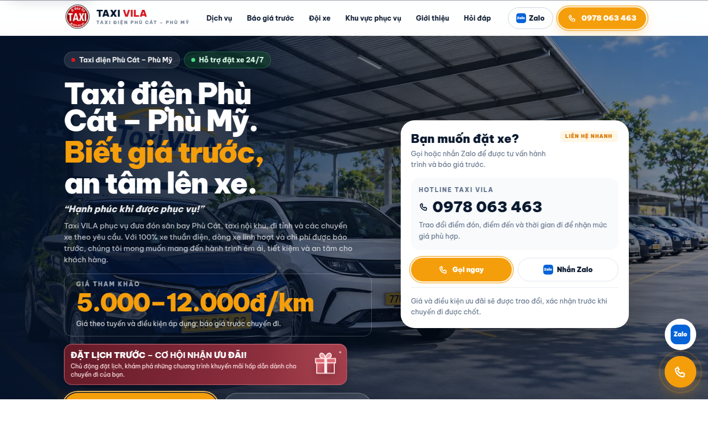

## Mục tiêu dự án

Website được xây dựng để:

- Giới thiệu rõ dịch vụ, đội xe và khu vực Taxi VILA đang phục vụ.
- Giúp khách gọi điện hoặc nhắn Zalo nhanh trên cả desktop và mobile.
- Thu thập thông tin chuyến đi bằng form, sau đó chuyển nội dung sang Zalo để tư vấn.
- Phát triển SEO địa phương cho các truy vấn như `taxi điện Phù Cát`, `taxi sân bay Phù Cát` và `taxi Phù Cát đi Quy Nhơn`.
- Giữ source tách biệt theo component, nội dung và nghiệp vụ để dễ mở rộng.

## Công nghệ

| Thành phần | Công nghệ |
| --- | --- |
| Framework | Next.js 15 App Router |
| Giao diện | React 19, TypeScript |
| CSS | Tailwind CSS 4 kết hợp CSS dùng chung |
| Font | Be Vietnam Pro |
| SEO | Next.js Metadata, JSON-LD, sitemap và robots |
| Triển khai | Vercel |

## Giao diện hiện tại

### 1. Dịch vụ

Khối dịch vụ trình bày các nhu cầu chính: đưa đón sân bay, taxi nội khu, đi tỉnh, khứ hồi và thuê xe theo lịch trình. Nội dung được quản lý trong `src/content/services.ts`.

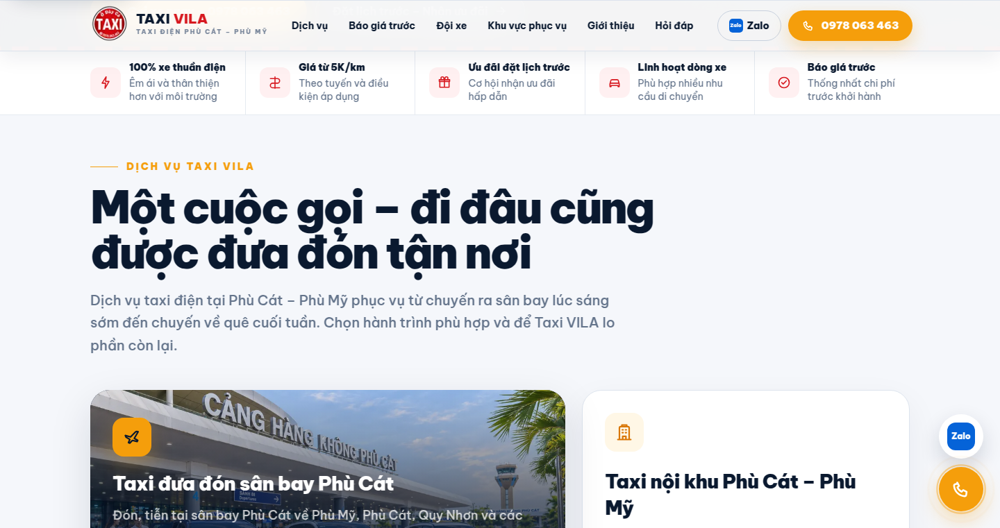

### 2. Lý do chọn Taxi VILA

Phần này làm rõ lợi thế báo giá trước, xe điện, hiểu địa phương và quy trình phục vụ. Dữ liệu nằm trong `src/content/why-vila.ts`.

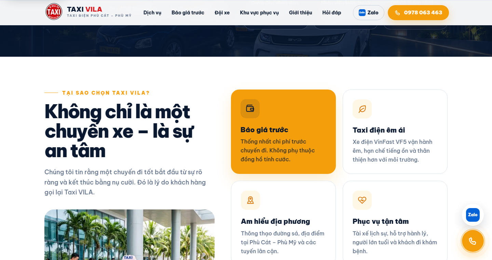

### 3. Đội xe

Giới thiệu hình ảnh xe thực tế, ngoại thất, nội thất và các đặc điểm chính của đội xe điện 5–7 chỗ. Dữ liệu hình ảnh nằm trong `src/content/fleet.ts`.

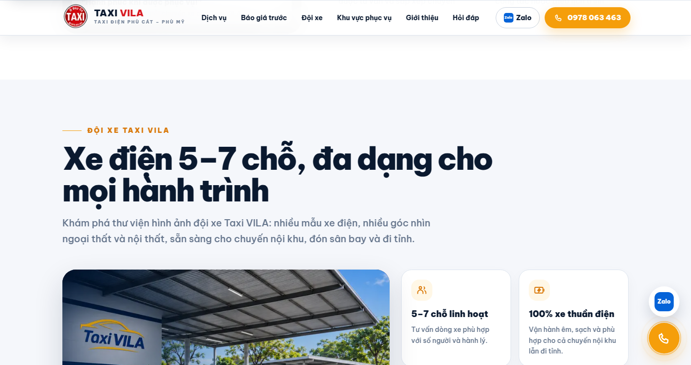

### 4. Khu vực và tuyến phổ biến

Các tuyến thường dùng được hiển thị dưới dạng thẻ, liên kết Google Maps và nút yêu cầu báo giá. Nội dung nằm trong `src/content/service-areas.ts`.

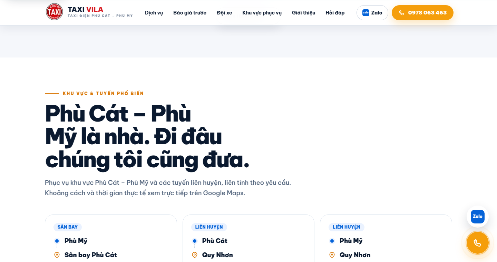

### 5. Đặt xe trực tuyến

Form nhận họ tên, số điện thoại, điểm đón, điểm đến, ngày giờ, loại chuyến và số hành khách. Sau khi hợp lệ, website tạo nội dung chuyến đi để khách gửi qua Zalo.

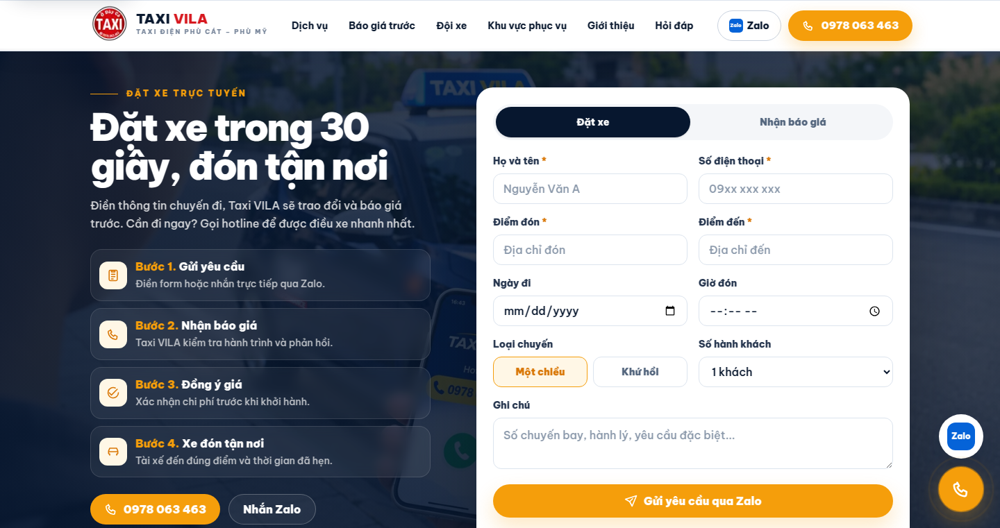

> Hiện tại form là luồng tư vấn qua Zalo, chưa lưu đơn vào cơ sở dữ liệu. API và trang admin mới là bộ khung để phát triển sau.

### 6. Giới thiệu và FAQ

Khối giới thiệu truyền tải định hướng phục vụ của Taxi VILA. FAQ giải đáp các câu hỏi phổ biến và đồng thời tạo dữ liệu có cấu trúc `FAQPage` cho SEO.

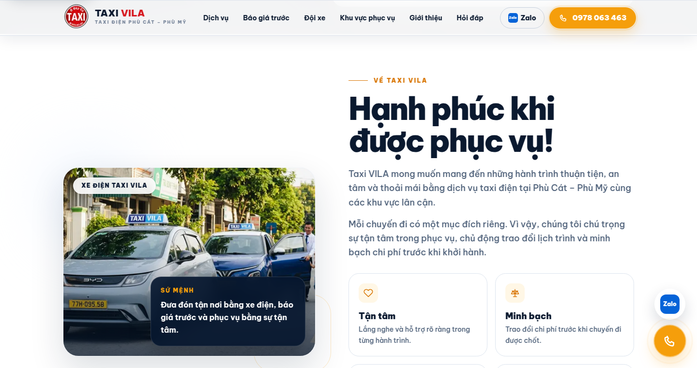

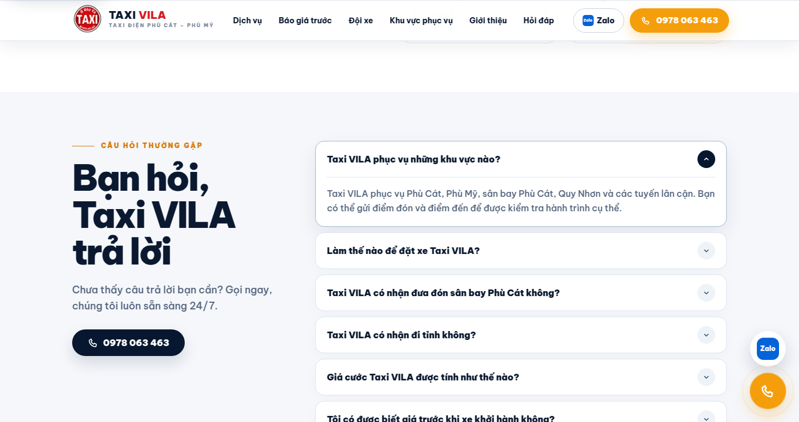

### 7. Landing page SEO

Website hiện có ba trang dịch vụ độc lập. Mỗi trang có H1, metadata, nội dung, FAQ, liên kết nội bộ và JSON-LD riêng.

#### Taxi sân bay Phù Cát

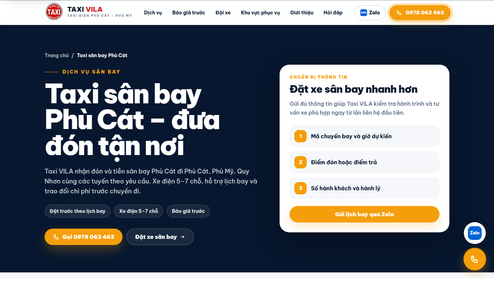

#### Taxi Phù Cát đi Quy Nhơn

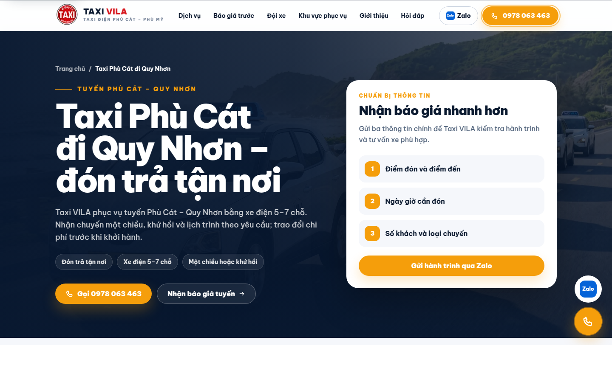

#### Taxi đi tỉnh từ Phù Cát – Phù Mỹ

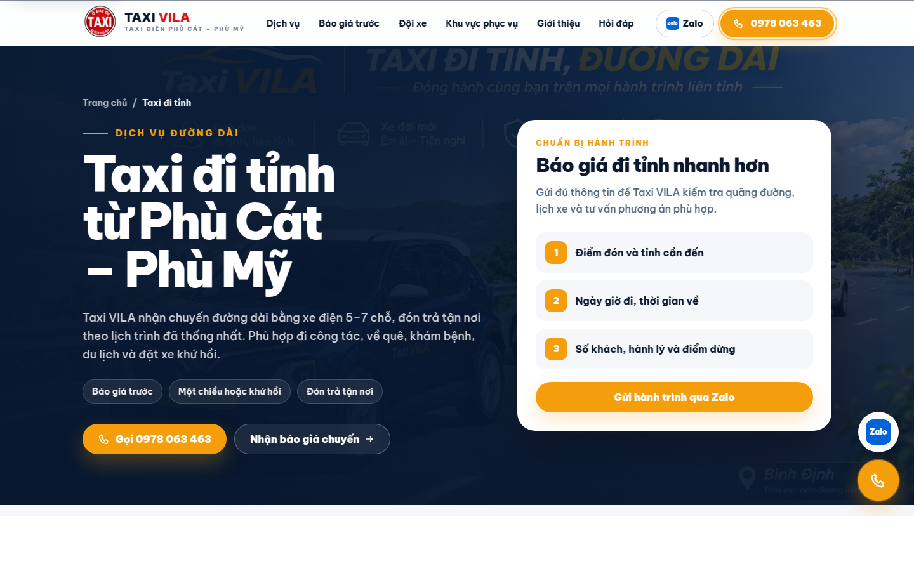

## Các route chính

| Route | Mục đích |
| --- | --- |
| `/` | Trang chủ và toàn bộ thông tin tổng quan |
| `/taxi-san-bay-phu-cat` | Landing page SEO dịch vụ sân bay Phù Cát |
| `/taxi-phu-cat-di-quy-nhon` | Landing page SEO tuyến Phù Cát – Quy Nhơn |
| `/taxi-di-tinh` | Landing page SEO taxi đi tỉnh và tuyến đường dài |
| `/sitemap.xml` | Danh sách URL gửi cho công cụ tìm kiếm |
| `/robots.txt` | Quy tắc thu thập dữ liệu |
| `/admin` | Bộ khung khu vực quản trị, chưa dùng trong production |
| `/api/bookings` | Bộ khung API đặt xe để phát triển sau |

## Khởi chạy dự án

### Yêu cầu

- Node.js 20 trở lên.
- npm đi kèm Node.js.

### Cài đặt

```bash
git clone <repository-url>
cd vila-taxi-77
npm install
cp .env.example .env
```

Cập nhật `.env`:

```env
NEXT_PUBLIC_SITE_URL=https://taxivila.com
GOOGLE_SITE_VERIFICATION=ma-xac-minh-google-search-console
```

Không commit file `.env`. Chỉ `.env.example` được dùng làm mẫu tên biến.

### Chạy môi trường phát triển

```bash
npm run dev
```

Mở [http://localhost:3000](http://localhost:3000).

### Kiểm tra bản production

```bash
npm run build
npm run start
```

Các script hiện có:

| Lệnh | Chức năng |
| --- | --- |
| `npm run dev` | Chạy development server |
| `npm run build` | Build và kiểm tra TypeScript bằng Turbopack |
| `npm run start` | Chạy production server sau khi build |

## Cấu trúc source

```text
vila-taxi-77/
├── docs/
│   └── screenshots/             # Ảnh minh họa dùng trong README
├── public/
│   ├── icons/                   # Icon tĩnh
│   └── images/                  # Logo, hero, xe, dịch vụ và giới thiệu
├── src/
│   ├── app/
│   │   ├── (site)/
│   │   │   ├── page.tsx         # Ghép các section của trang chủ
│   │   │   ├── layout.tsx       # Header, footer, liên hệ nổi
│   │   │   ├── taxi-san-bay-phu-cat/
│   │   │   └── taxi-phu-cat-di-quy-nhon/
│   │   ├── (admin)/             # Bộ khung quản trị
│   │   ├── api/bookings/        # Bộ khung API đặt xe
│   │   ├── layout.tsx           # Root layout và metadata chung
│   │   ├── globals.css
│   │   ├── robots.ts
│   │   └── sitemap.ts
│   ├── components/
│   │   ├── layout/              # Header, mobile menu, footer, liên hệ nổi
│   │   ├── sections/            # Các section của landing page
│   │   └── ui/                  # Component giao diện tái sử dụng
│   ├── config/                  # Thương hiệu, điều hướng và SEO
│   ├── content/                 # Nội dung tĩnh tách khỏi JSX
│   ├── features/booking/        # Form, schema, action, service và type đặt xe
│   ├── hooks/                   # Hook menu mobile và header
│   ├── lib/                     # Hàm tiện ích dùng chung
│   ├── styles/                  # Responsive CSS
│   └── types/                   # Type dùng chung
├── .env.example
├── next.config.ts
├── package.json
└── README.md
```

## Vai trò của từng lớp

### `src/app`

Quản lý route, layout, metadata, sitemap, robots và Route Handler theo Next.js App Router. `page.tsx` chỉ ghép các section, không chứa toàn bộ giao diện trong một file lớn.

### `src/components`

- `layout`: các thành phần bao quanh trang như header, menu mobile, footer và nút liên hệ nổi.
- `sections`: các khối lớn trên trang chủ.
- `ui`: các thành phần nhỏ có thể tái sử dụng.

### `src/content`

Chứa nội dung tĩnh và dữ liệu hiển thị. Khi đổi câu chữ, tuyến đường, FAQ hoặc ảnh đội xe, ưu tiên chỉnh tại đây thay vì viết trực tiếp trong component.

### `src/config`

- `site.ts`: tên thương hiệu, hotline, Zalo, giá tham khảo.
- `navigation.ts`: menu chính và liên kết section.
- `seo.ts`: domain canonical, metadata, tọa độ, Google Maps và các hàm JSON-LD.

### `src/features/booking`

Gom toàn bộ nghiệp vụ đặt xe: form, validate dữ liệu, type và hướng mở rộng backend. Chỉ các component cần state hoặc sự kiện trình duyệt mới dùng `"use client"`.

## Chỉnh nội dung thường dùng

| Muốn chỉnh | File chính |
| --- | --- |
| Hotline, Zalo, giá tham khảo | `src/config/site.ts` |
| Tiêu đề, mô tả, từ khóa, Maps, tọa độ | `src/config/seo.ts` |
| Menu header và mobile | `src/config/navigation.ts` |
| Danh sách dịch vụ | `src/content/services.ts` |
| Lý do chọn Taxi VILA | `src/content/why-vila.ts` |
| Đội xe và thư viện ảnh | `src/content/fleet.ts` |
| Khu vực và tuyến phổ biến | `src/content/service-areas.ts` |
| FAQ | `src/content/faqs.ts` |
| Nội dung trang sân bay | `src/content/airport-service.ts` |
| Nội dung trang Phù Cát – Quy Nhơn | `src/content/quy-nhon-service.ts` |
| Nội dung trang taxi đi tỉnh | `src/content/interprovincial-service.ts` |
| Thứ tự section trang chủ | `src/app/(site)/page.tsx` |

## SEO đang được triển khai

### SEO kỹ thuật

- Metadata chung và metadata riêng cho từng landing page.
- Canonical URL dùng domain `https://taxivila.com`.
- Open Graph và Twitter metadata để chia sẻ liên kết.
- `robots.txt` cho phép thu thập trang công khai và chặn `/admin`, `/api`.
- `sitemap.xml` gồm trang chủ và ba trang dịch vụ.
- Google Search Console verification qua biến môi trường.
- JSON-LD cho `Organization`, `WebSite`, `Service`, `FAQPage` và thư viện đội xe.
- Ảnh có nội dung `alt` cụ thể theo dịch vụ.
- Liên kết nội bộ từ trang chủ sang các landing page SEO.

### Nhóm từ khóa ưu tiên

1. `Taxi VILA`, `taxi điện Phù Cát`, `taxi Phù Mỹ`.
2. `Taxi sân bay Phù Cát`, `taxi đưa đón sân bay Phù Cát`.
3. `Taxi Phù Cát đi Quy Nhơn`, `xe đưa đón Phù Cát Quy Nhơn`.

### Khi thêm một trang dịch vụ mới

1. Tạo route có slug ngắn, dễ đọc trong `src/app/(site)`.
2. Viết một H1 duy nhất, title và description riêng, đúng ý định tìm kiếm.
3. Tạo nội dung hữu ích, tránh chỉ thay tên địa điểm trên nội dung cũ.
4. Thêm canonical, Open Graph và JSON-LD phù hợp.
5. Thêm liên kết từ trang chủ hoặc trang liên quan.
6. Bổ sung URL vào `src/app/sitemap.ts`.
7. Build, deploy, kiểm tra URL thật rồi yêu cầu lập chỉ mục trong Search Console.

### Quy trình Search Console sau khi deploy

1. Kiểm tra [https://taxivila.com/robots.txt](https://taxivila.com/robots.txt).
2. Kiểm tra [https://taxivila.com/sitemap.xml](https://taxivila.com/sitemap.xml).
3. Gửi `sitemap.xml` trong mục **Sơ đồ trang web**.
4. Dùng **Kiểm tra URL** cho trang mới.
5. Chọn **Yêu cầu lập chỉ mục**.
6. Theo dõi hiệu suất theo truy vấn, trang và lượt nhấp; Google có thể cần thời gian để thu thập và cập nhật kết quả.

> Hoàn tất kỹ thuật SEO không đồng nghĩa chắc chắn đứng đầu Google. Thứ hạng còn phụ thuộc nội dung, Google Business Profile, đánh giá thật, độ uy tín, liên kết và mức độ cạnh tranh.

## Deploy lên Vercel

1. Kết nối repository với Vercel.
2. Khai báo `NEXT_PUBLIC_SITE_URL=https://taxivila.com`.
3. Khai báo `GOOGLE_SITE_VERIFICATION` bằng mã Search Console.
4. Deploy và kiểm tra các route công khai.
5. Khi đổi domain, cập nhật biến môi trường, redeploy, kiểm tra canonical và gửi lại sitemap.

`NEXT_PUBLIC_SITE_URL` là cấu hình công khai, không phải mật khẩu. Mã verification cũng không phải khóa truy cập, nhưng vẫn nên quản lý tập trung qua biến môi trường.

## Responsive và khả năng thao tác

- Header desktop chuyển thành menu trượt trên mobile.
- Menu có animation mở/đóng, khóa cuộn nền và nút đóng rõ ràng.
- Nút gọi và Zalo được ghim để người dùng luôn thao tác nhanh.
- Các section chuyển từ nhiều cột sang một hoặc hai cột theo kích thước màn hình.
- Nút bấm có vùng thao tác đủ lớn và trạng thái hover/focus.
- Màu thương hiệu chính: xanh navy, trắng và vàng cam.

Nên kiểm tra ít nhất tại các mốc 375 px, 768 px, 1024 px và 1440 px trước mỗi lần deploy giao diện lớn.

## Quy ước code

- File và folder dùng `kebab-case`.
- Component và type dùng `PascalCase`.
- Hàm và biến dùng `camelCase`.
- Ưu tiên Server Component; chỉ dùng Client Component khi cần state, event hoặc API trình duyệt.
- Nội dung lặp lại đặt trong `config` hoặc `content`.
- Ảnh website đặt trong `public/images`, ưu tiên WebP/AVIF hoặc SVG phù hợp.
- Không hard-code hotline và Zalo ở nhiều component.
- Chạy `npm run build` trước khi push hoặc deploy.

## Hướng phát triển tiếp theo

- Kết nối form đặt xe với email, database hoặc dịch vụ thông báo phù hợp.
- Hoàn thiện xác thực và phân quyền cho trang admin.
- Lưu và quản lý trạng thái đơn đặt xe.
- Bổ sung đánh giá khách hàng thật sau khi có sự đồng ý.
- Theo dõi truy vấn Search Console để phát triển thêm landing page có nhu cầu thật.
- Tối ưu kích thước ảnh và Core Web Vitals khi thư viện hình ảnh tăng lên.

## Ghi chú ảnh README

Ảnh trong `docs/screenshots` được chụp từ bản production local ở viewport desktop 1440 × 900. Khi giao diện thay đổi lớn, nên chụp lại để README luôn khớp với website thực tế.
